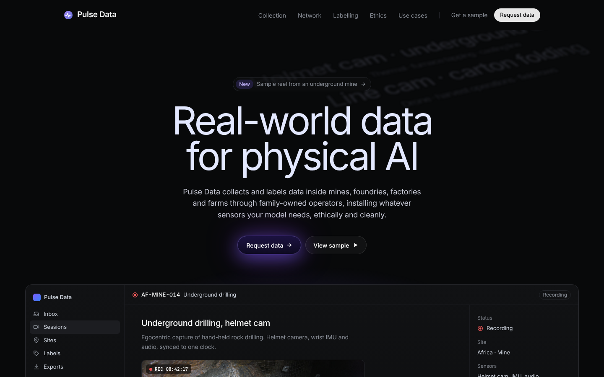

# Pulse Data landing page

The landing page for Pulse Data, a physical-world AI data collection and labelling company. It's plain HTML, CSS and JS with no build step.

## View it locally

Serve the folder and open http://localhost:8000:

```bash
python3 -m http.server 8000
```

You can also double-click `index.html`, but some browsers block the stylesheet and script over `file://` because of the security policy, so serving it is more reliable.

## Files

| File | What it is |
|---|---|
| `index.html` | The page |
| `styles.css` | All styles; colours and fonts are variables at the top |
| `main.js` | Nav blur on scroll, reveal-on-scroll, the labels toggle and form checks |
| `assets/mine-drill.webp` | The sample dataset frame |
| `_headers` | Security headers for Netlify or Cloudflare Pages |
| `PRODUCT.md`, `DESIGN.md` | Product facts and the design system |
| `SECURITY.md` | Security measures and the checklist for connecting the form |
| `.claude/skills/` | Design, motion and planning skills for Claude Code |

## Before launch

- **Connect the form.** See the `TODO` in `main.js` and the checklist in `SECURITY.md`.
- **Add real proof as it arrives.** The page deliberately has no stats, prices or customer names. Add them only when they're real.
- **More footage.** Every product mock uses the one mining frame. Add frames from packaging, manufacturing and farm sites as you get them.
- **Product mocks are illustrative.** The session view, board and label review show how a project runs; they aren't a live product. Adjust them if you build a real client portal.

The design follows linear.app and lemni.com closely, at the founder's request. See `DESIGN.md`.

## Preview


